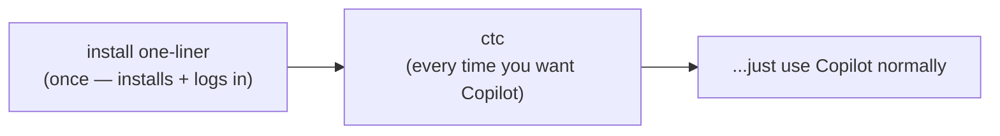
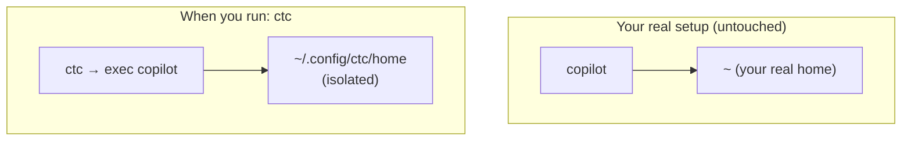

# 02 · The `ctc` command — the one-line launcher

> A small convenience tool (`cli/ctc`, a Bash script) so teammates don't have to
> configure environment variables and certificates by hand.

---

## Layer 1 — What it's for

To use Copilot through CTC, a few things must be set up on your machine: trust
CTC's certificate, point Copilot at the Proxy, and give Copilot your throwaway
token. Doing that by hand is fiddly and easy to get wrong.

The `ctc` command bundles it into **one setup line you run once**, then **one
command you run daily**:



The setup line comes from the website (Settings → "Set up CLI", or the first-run
walkthrough) with **your throwaway token already baked in**, so there's nothing to
paste:

```bash
curl -fsSL https://<ctc-host>/install.sh | sh -s -- --token <your-proxy-token>
```

That single command installs the `ctc` launcher **and** logs you in. (Prefer to do
it by hand? `ctc login` with no arguments still prompts you to paste the token —
see below.)

> The `https://` here follows the deployment's **web transport**. A deployment
> served over plain HTTP (VPN/LAN only) hands out an `http://` one-liner instead.
> The launcher's `CTC_SCHEME` is baked to match at build time, so the website
> always shows the right scheme — you don't choose it.

It also **keeps your CTC setup completely separate** from your personal Copilot.
Both can live on the same machine; running plain `copilot` still uses your own
account, untouched.

---

## Layer 2 — The commands

| Command | What it does |
|---|---|
| `ctc login` | Set up your machine: download + trust CTC's certificate and save your settings. Asks for your password once (to trust the cert). Pass `--token <t>` to supply the proxy token non-interactively (what the install one-liner uses); with no `--token`, it prompts you to paste it. |
| `ctc` | Launch Copilot through CTC. Any Copilot flags pass straight through (e.g. `ctc -p "explain this code"`). |
| `ctc status` | Show whether you're set up: the proxy host, the last 4 characters of your token, and whether the cert is trusted. Never prints the full token. |
| `ctc logout` | Remove your CTC settings. Your personal Copilot and GitHub config are left untouched. |
| `ctc --help` | Show usage. |

### How "kept separate" works

When you run `ctc`, it temporarily tells Copilot to use a **private home folder**
(`~/.config/ctc/home`) just for CTC. Copilot stores its CTC-specific settings
there, nowhere near your real ones. The moment you run plain `copilot` instead,
you're back to your normal, personal setup.



---

## Layer 3 — Under the hood

`ctc login` writes a settings file (`~/.config/ctc/env`, readable only by you)
that sets these environment variables whenever you run `ctc`:

| Variable | Why |
|---|---|
| `HTTPS_PROXY=http://<ctc-host>:8080` | Routes all of Copilot's traffic through the CTC Proxy. |
| `COPILOT_GITHUB_TOKEN=<your proxy token>` | The throwaway token that identifies you to CTC. |
| `GH_HOST=example.ghe.com` | Tells Copilot it's talking to the GitHub Enterprise host. |
| `HOME=~/.config/ctc/home` (+ XDG dirs) | The isolation trick — a private config home for CTC. |
| `NODE_EXTRA_CA_CERTS=~/.config/ctc/ca.pem` | Extra cert trust for Node-based tools. |

Then `ctc` simply **`exec`s the stock `copilot`** with those variables in place —
it never modifies Copilot itself.

### The VS Code `/ide` bridge

Copilot's `/ide` command (editor selection, diagnostics, open-file context) finds
your editor through a small workspace registry the VS Code companion writes to your
**real** `~/.copilot/ide`. But `ctc` runs Copilot under an *isolated* HOME, which
can't see that. So before launching, `ctc` **symlinks just `~/.copilot/ide`** from
the isolated home back to your real one — sharing *only* that registry, while your
token, session, and config under `~/.copilot` stay isolated. (It replaces any stale
isolated copy so the link is always fresh.) The result: `/ide` works inside a `ctc`
session exactly as it does in plain `copilot`.

### How the one-liner logs you in

`install.sh` accepts `--token <t>`: after it installs the `ctc` binary, if a token
was passed it runs `ctc login --token <t>` for you — so the single curl command both
installs and logs in. `ctc login --token <t>` just skips the interactive paste and
uses the supplied token; everything else (cert download, keychain trust, writing the
settings file) is identical to the prompted path. The token is your ordinary
**disposable proxy token** — revocable and rotatable in Settings — so it carrying
through your shell history is low-impact (it maps to a real PAT only *inside* the
proxy, and you can revoke it anytime).

### The certificate step (and why it needs `sudo` once)

`ctc login` downloads CTC's certificate and trusts it in the **macOS System
keychain** (`sudo security add-trusted-cert …`). This one-time password prompt is
necessary because Copilot ships its *own* copy of the Node runtime that ignores
the usual per-app cert settings — only OS-level trust convinces it. (`ctc logout`
tells you the command to remove the cert if you ever want to.)

### Platform note

`cli/ctc` (Bash) is **macOS-only** — its automatic certificate-trust step uses
the macOS `security` tool. There's also a **native Windows launcher**,
`cli/ctc.ps1` (+ `cli/install.ps1`), covering the same ground the PowerShell
way — see below. Linux has neither yet: do the same setup by hand — see
[`TDD.md`](../../TDD.md) §6.3.

### Windows

`cli/ctc.ps1` and `cli/install.ps1` are a **native PowerShell port** — zero
extra dependencies (no Python, WSL, or Git Bash required; built-in Windows
PowerShell 5.1 is enough, though `pwsh` is used when present). The one-liner
from the website's "Set up CLI" panel looks like this on Windows:

```powershell
curl.exe -fsSLko "$env:TEMP\ctc-install.ps1" https://<ctc-host>/install.ps1
powershell -NoProfile -File "$env:TEMP\ctc-install.ps1" -Token <your-proxy-token>
```

It downloads the installer **to a file first, then runs it as a file** —
deliberately not a `curl | iex` download cradle, which is a pattern security
tools commonly flag. It never passes `-ExecutionPolicy Bypass` either. If your
effective policy is `Restricted` (the Windows client default), PowerShell itself
refuses to start the installer with *"running scripts is disabled on this
system"*; run this once in your own, non-admin PowerShell and re-run the
one-liner:

```powershell
Set-ExecutionPolicy -Scope CurrentUser RemoteSigned
```

The installer also re-checks the effective policy and prints the same hint
rather than ever working around it.

**Certificate trust, without admin.** `ctc login` trusts CTC's certificate in
`Cert:\CurrentUser\Root` by default — Windows shows its native "install this
certificate?" confirmation dialog, no password or elevation needed. That's a
deliberate choice over the machine-wide store: it keeps the install one-liner
from ever needing to elevate (the earlier security guidance for the macOS
launcher was specifically about **not** having the website's one-liner invoke
`sudo`/admin — see the plan's EDR assessment). If you need the certificate
trusted for *all* users on the machine, run `ctc login -Machine` yourself from
a shell **you've already elevated**; the launcher never self-elevates (no
`Start-Process -Verb RunAs`).

**Environment.** The same isolation trick applies, translated to Windows
conventions:

| Variable | Why |
|---|---|
| `HTTPS_PROXY=http://<ctc-host>:8080` | Routes Copilot/Claude traffic through the CTC Proxy. |
| `COPILOT_GITHUB_TOKEN=<your proxy token>` | The throwaway token that identifies you to CTC. |
| `GH_HOST=example.ghe.com` | Tells Copilot it's talking to the GitHub Enterprise host. |
| `USERPROFILE=%APPDATA%\ctc\home` (+ `HOME` and `XDG_CONFIG_HOME`/`XDG_STATE_HOME`/`XDG_CACHE_HOME` under it) | The isolation trick on Windows — Node's `os.homedir()` reads `USERPROFILE`, not `HOME`. |
| `NODE_EXTRA_CA_CERTS=%APPDATA%\ctc\ca.pem` | Extra cert trust for Node-based tools. |

**The `/ide` bridge** works the same way as macOS, substituting a **directory
junction** (`New-Item -ItemType Junction`, no admin or Developer Mode required)
for the Unix symlink, bridging `%USERPROFILE%\.copilot\ide` into the isolated
home.

**Why no shortcuts.** The design deliberately avoids patterns security tooling
(e.g. CrowdStrike Falcon) commonly scores as malicious: no download cradle, no
`-ExecutionPolicy Bypass`, no hidden/background PowerShell windows (the
update-check, price-refresh, and ledger-poll background work all run as
runspaces *inside* the visible launcher process instead — PowerShell has no
`exec`, so the launcher stays alive as the agent's parent anyway), no
`certutil`, no `Unblock-File`, no TLS-validation-callback overrides, and no
obfuscation (`-EncodedCommand`, base64, string-built commands). A Pester
hygiene test greps both scripts for these patterns on every change.

**Next:** how logging in and the two kinds of tokens work →
[03 · Identity & login](03-identity-and-login.md).
